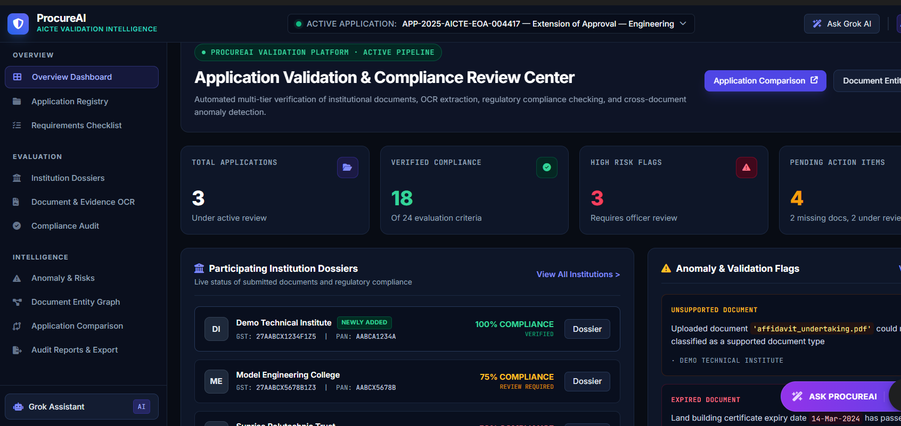
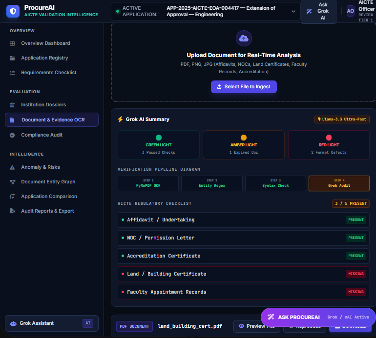
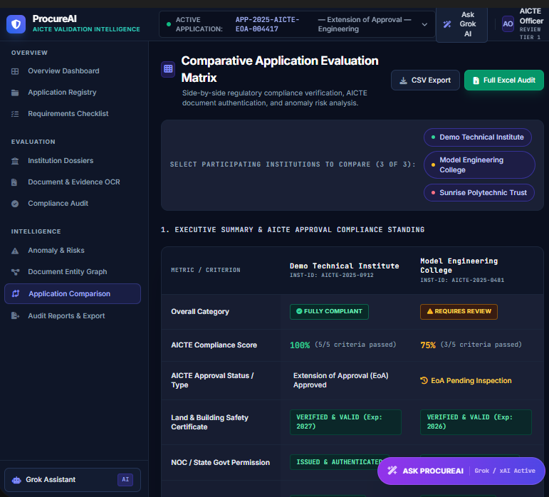
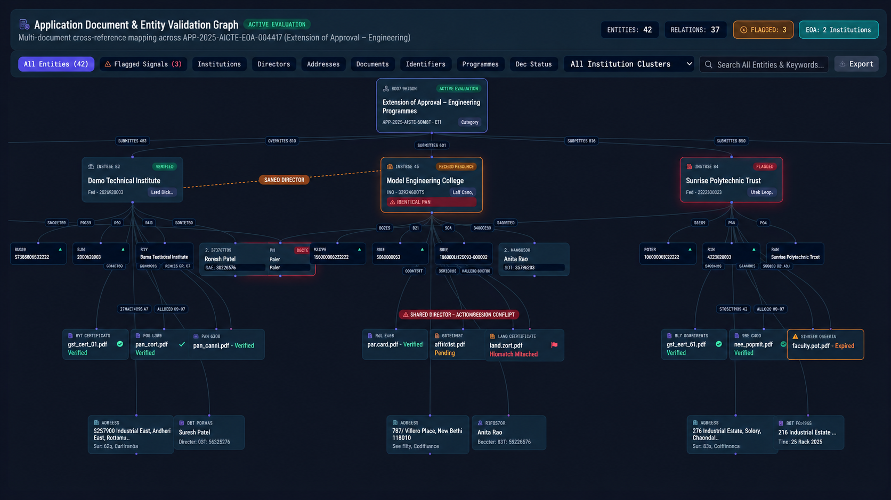
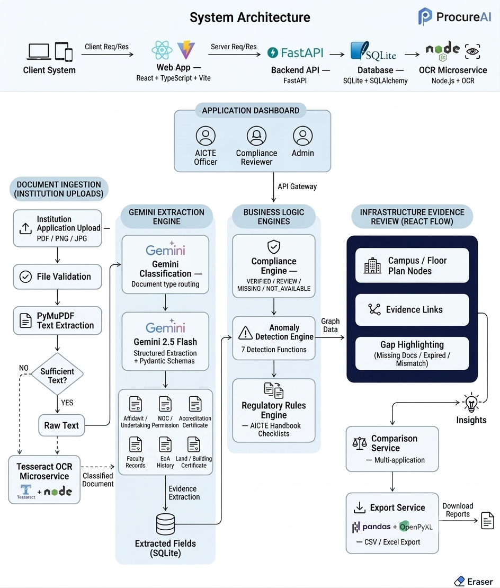
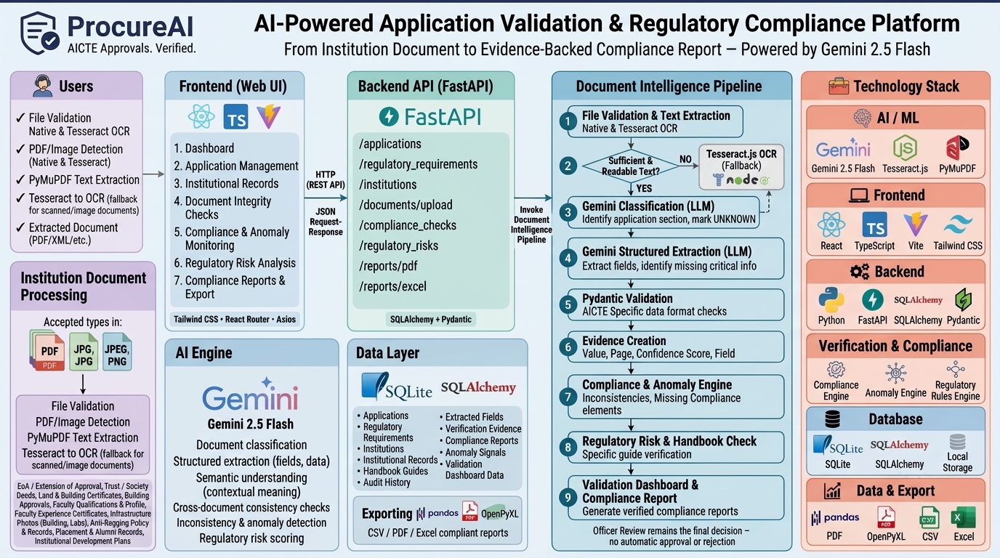

# ProcureAI — AI-Powered Application Validation, Document Authentication and Regulatory Compliance Verification

[](https://www.python.org/) [](https://fastapi.tiangolo.com/) [](https://react.dev/) [](https://www.typescriptlang.org/) [](https://vitejs.dev/) [](https://tailwindcss.com/) [](https://ai.google.dev/) [](https://groq.com/) [](https://github.com/naptha/tesseract.js) [](https://www.sqlite.org/) [](https://reactflow.dev/)

> **"From institutional documents to structured, evidence-backed application validation."**

---

## 🖥️ Project preview 






**ProcureAI** is an AI-powered platform designed to help validate institutional applications, review supporting documents, identify inconsistencies, and assist with regulatory compliance checks. It aims to make the preliminary scrutiny of applications more consistent, transparent, and evidence-based

---

## 🎯 Problem Statement

The All India Council for Technical Education (AICTE), under the Ministry of Education, processes applications from technical institutions for Extension of Approval (EoA) and other approval-related changes.

Reviewing these applications involves checking institutional records, supporting documents, expiry dates, and compliance with applicable requirements. Manual verification can be time-consuming, while missing documents, inconsistent information, possible document alterations, and delays in confirming details with issuing authorities can increase administrative effort.

There is a need for a secure, AI-enabled platform that helps identify these issues early, supports document authentication, and assists authorized officials in regulatory review.
---

## 💡 Solution

ProcureAI proposes an AI-powered application validation workflow that combines OCR, document understanding, structured information extraction, rule-based validation, anomaly detection, and evidence-linked reporting.

The platform is designed to identify missing or expired documents, compare information across application records, flag potential document anomalies, and support verification through authorized sources wherever available. It can also assist in checking institutional infrastructure evidence and identifying cases that may need additional documents or physical inspection.

Institutional Application
          ↓
Application Category & Checklist
          ↓
Supporting Document Upload
          ↓
PDF Text Extraction / OCR
          ↓
AI Document Classification
          ↓
Structured Information Extraction
          ↓
Field & Document Validation
          ↓
Cross-Document Consistency Checks
          ↓
Authorized Source Verification
          ↓
Regulatory Compliance Assessment
          ↓
Evidence-Linked Findings & Alerts
          ↓
Application Review Dashboard
          ↓
Authorized Officer Review

The platform serves as a decision-support tool. Potential anomalies require further verification, and final regulatory decisions remain with the competent AICTE authorities.

## 🏗️ System Architecture



## 🛠️ Technology Stack



---

## 📁 Project Structure

```text
procure_ai_prototype/
│
├── backend/
│   ├── routers/
│   ├── schemas/
│   ├── services/
│   ├── models/
│   ├── uploads/
│   ├── config.py
│   ├── database.py
│   ├── main.py
│   ├── seed.py
│   └── requirements.txt
│
├── frontend/
│   ├── src/
│   ├── public/
│   ├── package.json
│   └── vite.config.*
│
├── ocr_worker/
│   ├── server.js
│   ├── package.json
│   ├── package-lock.json
│   └── eng.traineddata
│
├── package.json
├── package-lock.json
└── README.md
```
